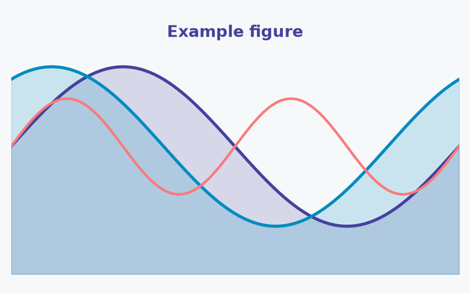

# Figures, math and cross-references

MyST supports a full range of scientific publishing features natively.

## Images and figures

MyST has three native ways to include an image, and they all work here. Pick by what you need:

| Form | Use it when | You get |
|---|---|---|
| `` | A plain image, no options | Alt text |
| `{image}` | You need to control the size or alignment | `:alt:`, `:width:`, `:align:` |
| `{figure}` | The image needs a caption, a number or a cross-reference | All of the above, plus a caption, `:label:` and `{numref}` |

Just reference a local image by its path; the kit publishes every image a page
displays for the Colab/Kaggle notebooks automatically, so no declaration is
needed (you only use `{nma-data}` for files your *code* reads, see
[W1D2 Tutorial 5](images-and-data.md)):

```markdown

```


```{image} images/example_figure.png
:alt: An example figure, resized
:width: 30%
:align: center
```

```{figure} images/example_figure.png
:label: fig-example
:alt: An example figure used to demonstrate the figure directive
:width: 60%

A figure with a caption and a label. Reference it elsewhere with {numref}`fig-example`.
```

The image lives in `images/` next to this page. Paths are relative to the page,
which is also the working directory when the page's code runs.

In the generated notebooks all three forms become an `` that Colab renders,
with the file's published URL. `{image}` and `{figure}` keep `:alt:` and
`:width:`, and a figure's caption becomes an italic line under it. Labels,
numbering, `{numref}` and `:align:` only exist on the site, so don't rely on them
for what a notebook reader needs to understand.

## Where images and data files go

Keep a day's files in that day's folder, next to the pages that use them:

    tutorials/W1D1_GettingStarted/
      W1D1_Tutorial3.md
      images/example_figure.png     # figures
      data/                         # small data files (create it when you need it)

- **Beside the page.** With only one or two files, put them directly next to the page. Add `images/` and `data/` once a day has more.
- **Site-wide files** (a custom logo, `extra.css`) go in a root `_static/` folder, which you create when needed (see W1D3 Tutorial 3).
- **On the site**, relative image paths just work.
- **In the generated notebooks** (Colab/Kaggle), every image a page displays is copied to `notebooks-branch` automatically (no declaration needed), and the download cell fetches files you declare with `{nma-data}` (the files your code reads). The kit's folders are `images/` and `data/` (and `slides/` for `{nma-slides}` PDFs), see [W1D2 Tutorial 5](images-and-data.md). For any other file a notebook needs, use an absolute URL: `https://raw.githubusercontent.com/<org>/<repo>/main/tutorials/<Day>/<file>`. In the browser, fetch data files with `pyodide.http.open_url` (see W1D2 Bonus), since Pyodide has no sockets.

## Math

Inline math: $E = mc^2$

Display math with a label:

$$
\int_{-\infty}^{\infty} e^{-x^2} dx = \sqrt{\pi}
$$ (eq-gaussian)

Reference equations: see {eq}`eq-gaussian`.

## Cross-references

Label any heading with (label)= and reference it with the ref role.

(sec-crossref-demo)=
### This section has a label

Refer back to it anywhere in the book using: ref to sec-crossref-demo.

## Matplotlib figures from code

```{code-cell} python
import matplotlib.pyplot as plt
import numpy as np

fig, ax = plt.subplots(figsize=(6, 3))
x = np.linspace(0, 2 * np.pi, 200)
ax.plot(x, np.sin(x), label="sin(x)")
ax.plot(x, np.cos(x), label="cos(x)")
ax.legend()
ax.set_xlabel("x")
ax.set_title("Trigonometric functions")
plt.tight_layout()
```

## Tables

| Column A | Column B | Column C |
|----------|----------|----------|
| Value 1  | Value 2  | Value 3  |
| Value 4  | Value 5  | Value 6  |

## Summary

- Use `{figure}` for captioned, numbered images, `{image}` for sizing, and plain Markdown for the simple case
- Use double-dollar signs for display math with optional equation labels
- Use (label)= syntax to label headings and cross-reference them
- Code cells produce embedded figures automatically
